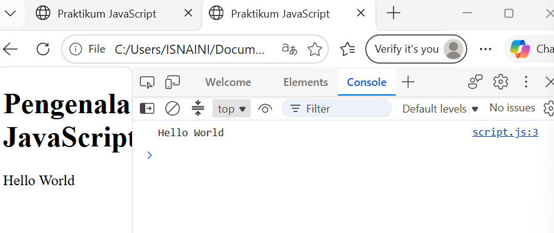
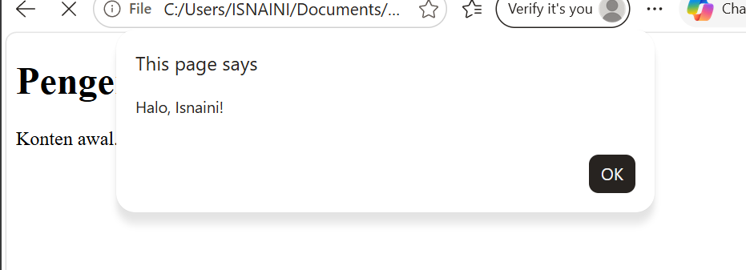
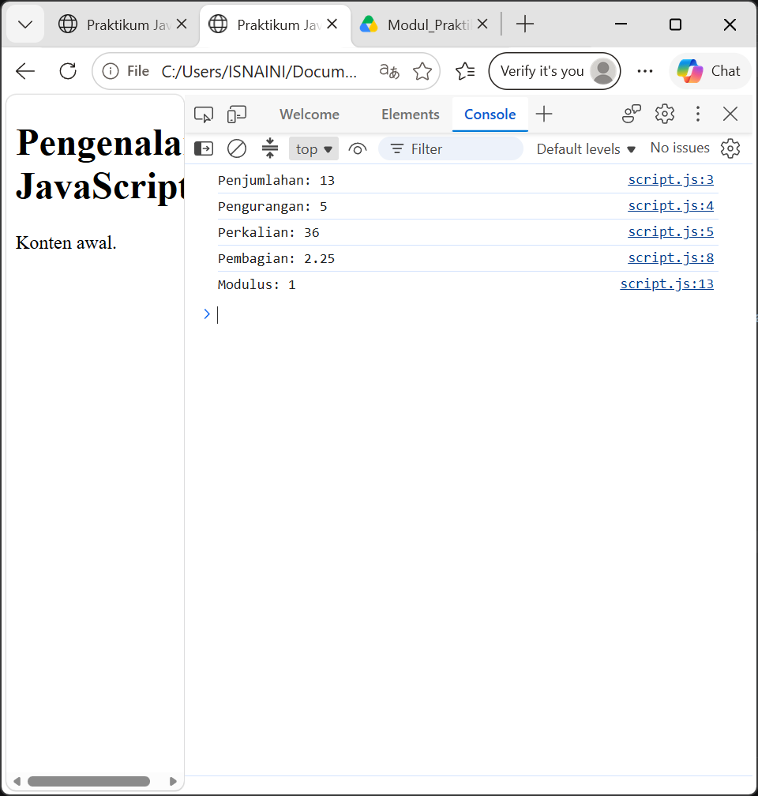

# Lab5Web.

# Praktikum 5 — JavaScript Dasar dan Manipulasi HTML

## Deskripsi
Praktikum ini mempelajari dasar JavaScript dan penerapannya pada halaman HTML, mulai dari menampilkan pesan, operasi aritmetika, percabangan, function, hingga manipulasi DOM.

## Tujuan
- Memahami dasar penggunaan JavaScript.
- Menggunakan variabel, operator, percabangan, dan function.
- Memanipulasi elemen HTML menggunakan JavaScript.
- Membuat halaman web yang interaktif.

## Tools
- Visual Studio Code
- Microsoft Edge
- HTML
- JavaScript

## Daftar Latihan

1. **Latihan 1 — Hello World**  
   Menampilkan pesan menggunakan JavaScript.
   
2. **Latihan 2 — Prompt dan Alert**  
   Menerima input dan menampilkan pesan kepada pengguna.
   
3.   **Latihan 3 — Operasi Aritmetika**  
   Melakukan perhitungan menggunakan operator aritmetika.
  
. **Latihan 5 — Switch**  
   Menjalankan perintah berdasarkan pilihan.
7. **Latihan 6 — Pengecekan Bilangan Bulat**  
   Memeriksa bilangan genap, ganjil, dan validitas input.
8. **Latihan 7 — Mengubah Warna Halaman**  
   Mengubah warna latar menggunakan tombol dan function.
9. **Latihan 8 — Checkbox Menu Makanan**  
   Menghitung total harga dari menu yang dipilih.

## Mini Project — Kalkulator Nilai Mahasiswa

Mini project menerima nilai Tugas, UTS, dan UAS, kemudian menghitung nilai akhir, menentukan predikat, dan menampilkan status kelulusan.

Bobot penilaian:
- Tugas: 30%
- UTS: 30%
- UAS: 40%

Program juga memvalidasi nilai agar berada pada rentang 0–100.

## Cara Menjalankan
1. Buka folder proyek di Visual Studio Code.
2. Buka file `index.html` menggunakan browser.
3. Jalankan setiap latihan dan uji fitur yang tersedia.
4. Simpan screenshot hasil praktikum.

## Dokumentasi Hasil
Tambahkan screenshot setiap latihan pada bagian ini.

Contoh penulisan gambar:

Sesuaikan nama file gambar dengan screenshot yang benar-benar kamu simpan.

## Kesimpulan
Praktikum ini membantu memahami dasar JavaScript dan penerapannya untuk membuat halaman web yang interaktif melalui input pengguna, percabangan, function, dan manipulasi DOM.
